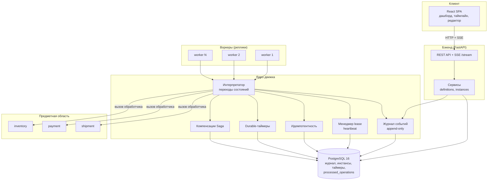
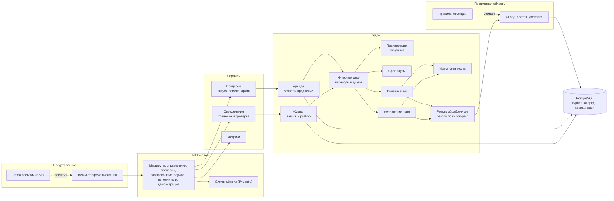
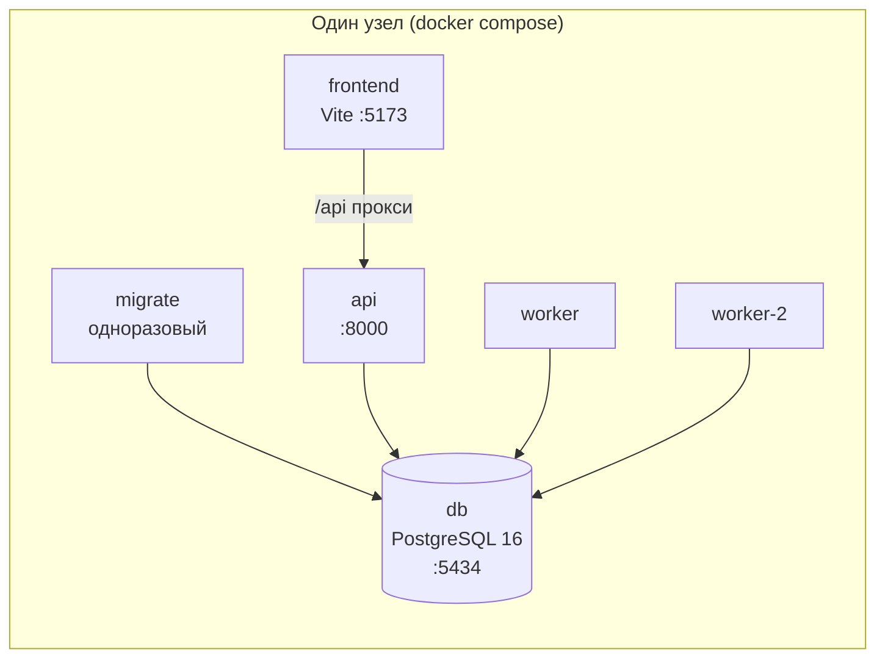

# Архитектура

Документ описывает, из чего состоит система, как подсистемы взаимодействуют и
почему именно так. Механизмы ядра разобраны отдельно в [`ENGINE.md`](ENGINE.md),
схема данных — в [`DATA-MODEL.md`](DATA-MODEL.md).

---

## 1. Постановка задачи

Бизнес-транзакция длится минуты и часы: резерв товара, ожидание оплаты,
передача в доставку, подтверждение получения. Транзакция PostgreSQL при этом
живёт миллисекунды. Классический ACID к такой задаче неприменим: удерживать
блокировки строк на час — значит заблокировать весь склад.

Требуется система, которая:

- исполняет произвольные бизнес-процессы, описанные данными, а не кодом;
- переживает падение воркера в любой момент без потери и без дублей работы;
- обеспечивает взаимноисключающее исполнение инстанса при нескольких воркерах;
- при неудаче откатывает уже выполненные шаги, а не оставляет процесс в
  промежуточном состоянии;
- наблюдаема: полный журнал событий, тайминги, метрики, живой интерфейс.

---

## 2. Обзор системы

Источник схемы — [`diagrams/system-context.mmd`](diagrams/system-context.mmd).

---

## 3. Подсистемы

Источник — [`diagrams/components.mmd`](diagrams/components.mmd).

| Подсистема | Модуль | Ответственность |
|---|---|---|
| Журнал | `app/engine/journal.py` | Append-only запись событий, выделение `seq`, replay |
| Интерпретатор | `app/engine/interpreter.py` | Переходы состояний, ветвления, циклы, выбор следующего шага |
| Аренда и восстановление | `app/engine/lease.py` | Захват, heartbeat, освобождение; подбор экземпляров с истёкшей арендой |
| Планировщик | `app/engine/scheduler.py` | Durable-таймеры ожидания |
| Срок паузы | `app/engine/deadline.py` | Истечение `pause_timeout_seconds` — отмена и откат |
| Исполнение шага | `app/engine/executor.py` | Вызов обработчика, продление аренды, запись результата |
| Saga | `app/engine/saga.py` | Компенсации в обратном порядке, повторы |
| Идемпотентность | `app/engine/idempotency.py` | `ProcessedOperation` |
| Реестр обработчиков | `app/engine/registry.py` | Резолв обработчика по import-path |
| API | `app/routers/` | REST по определениям, процессам, потоку событий, службе, исполнителям и демонстрации |
| Реестр исполнителей | `app/services/registry.py` | Сердцебиение и состояния `active` / `stale` / `stopped` |
| Воркер | `app/worker.py` | Цикл опроса |
| Предметная область | `app/demo/` | Обработчики inventory / payment / shipment |

---

## 4. Ключевые архитектурные решения

### 4.1 Durable execution вместо длинной транзакции

Транзакция уровня бизнес-процесса не выражается блокировкой строк. Она
выражается последовательностью коротких коммитов, каждый из которых пишет
событие в append-only журнал. Текущее состояние инстанса — результат replay'а
журнала.

Причина: транзакция БД, удерживающая блокировки часами, блокирует всё, что
эти строки затрагивает, и не переживает падение процесса — откат уничтожает
часы работы. Журнал переживает: событие уже записано — оно переиграется.

Полное обоснование — [ADR-0002](adr/0002-zhurnal-sobytiy-vmesto-dolgoy-tranzakcii.md).

### 4.2 Lease вместо распределённых блокировок

Инстанс обрабатывается ровно одним воркером в любой момент, но воркер может
умереть в любой момент. Координация построена на трёх колонках (`lease_owner`,
`lease_expires_at`, `heartbeat_at`) и атомарном `UPDATE` с условием на истёкший
lease. Никаких `pg_advisory_lock`: удержание блокировки между шагами — это
утечка, которая вешает инстанс навсегда.

Обоснование — [ADR-0003](adr/0003-lease-vmesto-raspredelennyh-blokirovok.md).

### 4.3 Saga вместо двухфазной фиксации

Часть шагов необратима: деньги списаны, товар отправлен. 2PC требует, чтобы
все участники поддерживали prepare/commit, что невозможно для HTTP-сервисов.
Вместо этого у каждого шага объявлена компенсация, а откат выполняется в
обратном порядке — как отмена уже свершившихся действий.

Обоснование — [ADR-0004](adr/0004-saga-vmesto-dvukhfaznoy-commit.md).

### 4.4 At-least-once плюс идемпотентность

Доставка событий гарантируется как at-least-once; exactly-once в
распределённой системе не существует. Повтор шага безопасен потому, что
обработчик сначала проверяет `processed_operations` и только затем применяет
эффект.

Обоснование — [ADR-0005](adr/0005-at-least-once-i-idempotentnost.md).

---

## 5. Развёртывание

Отдельные сервисы воркеров — не украшение: конкуренция за инстансы через
`SKIP LOCKED` и lease проверяется только на нескольких процессах. Один воркер
не способен воспроизвести гонку, которую система обязана выдерживать.

Порядок старта задан в `docker-compose.yml`: `db` → `migrate` (до завершения) →
`api`, `worker`, `worker-2`.

---

## 6. Поток данных одного шага

Шаг исполняется в пяти коротких транзакциях, ни одна из которых не охватывает
внешний вызов:

1. захват lease и выбор инстанса (`FOR UPDATE SKIP LOCKED`);
2. чтение журнала и `replay()` состояния;
3. отметка начала шага в `step_runs` + событие `STEP_STARTED`;
4. **внешний вызов без открытой транзакции** — здесь обновляется heartbeat;
5. запись результата, освобождение lease.

Подробная последовательность — [`ENGINE.md` §3](ENGINE.md#3-последовательность-исполнения-шага).

---

## 7. Предметная область

Демонстрационный процесс «Заказ»:

| Шаг | Компенсация | Что делает |
|---|---|---|
| `validate_cart` | — | проверка позиций заказа |
| `reserve_inventory` | `release_inventory` | резерв товара на складе |
| `charge_payment` | `refund_payment` | списание средств |
| `create_shipment` | `cancel_shipment` | передача в доставку |
| `confirm_delivery` | — | подтверждение получения |

Контрольный сценарий: сбой на шаге `charge_payment` → движок выполняет
`release_inventory` и возвращает инстанс в состояние `COMPENSATED`. Склад
приходит к исходному остатку, платёж переходит из `HELD` в `REFUNDED` — это
проверяется по данным, а не только по журналу событий.

Второй сценарий: заказ больше остатка. Шаг резервирования падает на
ограничении `reserved <= available`, и откат запускается без подставной
инъекции сбоя.

---

## 8. Развитие архитектуры

| Фаза | Что появляется в архитектуре |
|---|---|
| 1 | Модели данных, миграции, валидация дефинишена |
| 2 | Ядро: журнал, интерпретатор, lease, восстановление, таймеры, Saga |
| 3 | REST/SSE API, chaos-инъекции, метрики |
| 4 | Фронтенд: таймлайн, редактор, панель chaos |
| 5 | Нагрузочные замеры, устойчивость |
| 6 | Комплект документации, акт внедрения |

Планируется линейное масштабирование — через добавление реплик `worker` в
compose. Архитектура к этому готова: состояние в БД, координация через lease,
никакой привязки к памяти процесса. Горизонтальное масштабирование БД не
планируется: журнал событий предполагает один источник истины.