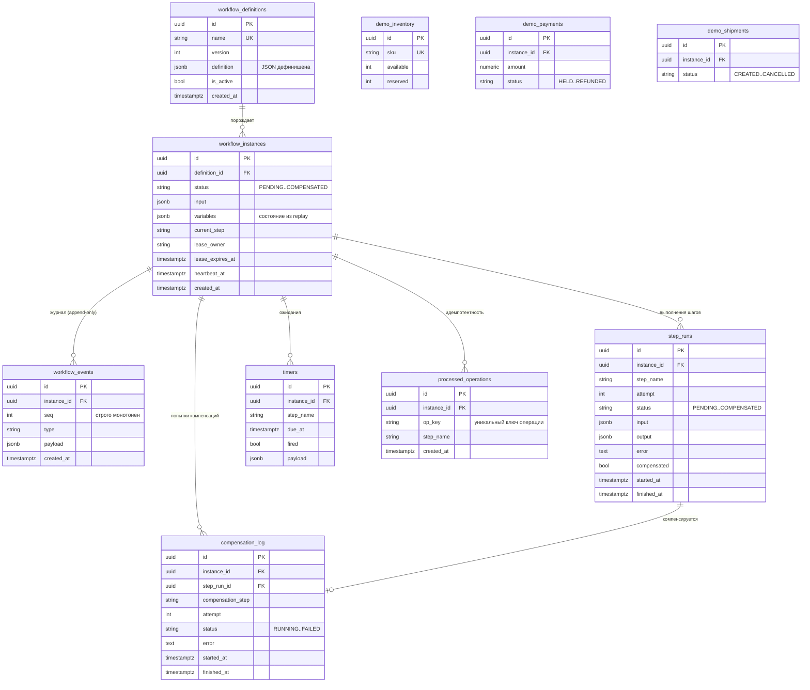

# Модель данных

Схема PostgreSQL, назначение таблиц, индексы и правила работы с ними.
Создаётся миграциями Alembic; версия схемы определяется версией кода.

---

## 1. Обзор



Источник — [`diagrams/er.mmd`](diagrams/er.mmd).

---

## 2. Таблицы

### 2.1 `workflow_definitions`

Дефинишены процессов — данные, а не код. Новый процесс добавляется без
изменений движка.

| Колонка | Тип | Назначение |
|---|---|---|
| `id` | `uuid` | Первичный ключ |
| `name` | `text UNIQUE` | Имя дефинишена |
| `version` | `integer` | Версия; `(name, version)` — уникальная пара |
| `definition` | `jsonb` | Граф шагов, компенсаций, переходов |
| `is_active` | `boolean` | Активна ли версия для запуска |
| `created_at` | `timestamptz` | Создание |

`jsonb`, а не отдельные таблицы на шаги: структура графа известна только в
момент запуска инстанса, а схема дефинишена может меняться приложением.
Нормализованные таблицы шагов дали бы пустую модель при изменении формата.

Индекс `GIN (definition)` — только если появится запрос поиска по шагам;
при текущем сценарии дефинишены читаются по имени.

### 2.2 `workflow_instances`

| Колонка | Тип | Назначение |
|---|---|---|
| `id` | `uuid` | Первичный ключ |
| `definition_id` | `uuid FK` | Ссылка на дефинишен |
| `status` | `text` | Состояние машины |
| `input` | `jsonb` | Входные данные инстанса |
| `variables` | `jsonb` | Результат replay — кэш, не источник истины |
| `current_step` | `text` | Шаг, готовый к исполнению |
| `lease_owner` | `text` | Идентификатор воркера-арендатора |
| `lease_expires_at` | `timestamptz` | Момент истечения аренды |
| `heartbeat_at` | `timestamptz` | Последнее продление |
| `created_at` | `timestamptz` | Создание |

**`variables` — не источник истины.** Это денормализованный результат replay,
ускоряющий выбор следующего шага. Восстановление читает журнал, а не
`variables`: иначе рассинхронизация кэша и журнала станятся источником
тихих ошибок. Инвариант §3.1 `AGENTS.md` требует, чтобы статус менялся
только записью события — прямое `UPDATE status` в обход журнала запрещено.

### 2.3 `workflow_events`

| Колонка | Тип | Назначение |
|---|---|---|
| `id` | `uuid` | Первичный ключ |
| `instance_id` | `uuid FK` | Владелец события |
| `seq` | `integer` | Порядковый номер внутри инстанса |
| `type` | `text` | Тип события |
| `payload` | `jsonb` | Данные события |
| `created_at` | `timestamptz` | Момент записи |

Ограничения:

- `UNIQUE (instance_id, seq)` — гарантирует монотонность без пропусков;
- `CHECK (seq >= 0)`;
- **`UPDATE` и `DELETE` запрещены** на уровне приложения; при необходимости —
  правило в БД, отклоняющее их.

`ON DELETE CASCADE` для `instance_id` **не используется**: удаление инстанса
уничтожило бы журнал, а вместе с ним возможность восстановления.

Индексы:

| Индекс | Обоснование |
|---|---|
| `UNIQUE (instance_id, seq)` | Порядок replay'а; защита от дубликатов при гонке |
| `(instance_id, created_at)` | Выборка событий инстанса за период в UI |
| `(type, created_at)` | Метрики по типам событий |

### 2.4 `step_runs`

Дополняет журнал техническими деталями исполнения: тайминги, попытки,
вход и выход шага.

| Колонка | Тип | Назначение |
|---|---|---|
| `id` | `uuid` | Первичный ключ |
| `instance_id` | `uuid FK` | Владелец |
| `step_name` | `text` | Имя шага |
| `attempt` | `integer` | Номер попытки, с 1 |
| `status` | `text` | `PENDING`…`COMPLETED`/`FAILED`/`COMPENSATED` |
| `input` / `output` | `jsonb` | Данные шага |
| `error` | `text` | Текст ошибки последней попытки |
| `compensated` | `boolean` | Компенсация выполнена |
| `started_at` / `finished_at` | `timestamptz` | Тайминги |

Разделение таблиц осознанное: журнал отвечает на вопрос «что произошло»,
`step_runs` — «сколько заняло и с каким результатом». Смешивать их означало бы
записывать инженерные детали в append-only поток.

Индексы: `(instance_id, step_name)`, `(instance_id, status, finished_at DESC)`
— последний обслуживает выбор шагов к компенсации в обратном порядке.

### 2.5 `timers`

| Колонка | Тип | Назначение |
|---|---|---|
| `id` | `uuid` | Первичный ключ |
| `instance_id` | `uuid FK` | Владелец |
| `step_name` | `text` | Шаг после срабатывания |
| `due_at` | `timestamptz` | Момент срабатывания |
| `fired` | `boolean` | Сработал ли |
| `payload` | `jsonb` | Данные ожидания |

Индекс: `(fired, due_at)` — выборка сработавших таймеров идёт постоянно.

### 2.6 `processed_operations`

| Колонка | Тип | Назначение |
|---|---|---|
| `id` | `uuid` | Первичный ключ |
| `instance_id` | `uuid FK` | Владелец |
| `op_key` | `text` | Ключ операции |
| `step_name` | `text` | Шаг |
| `created_at` | `timestamptz` | Момент применения |

**`UNIQUE (instance_id, op_key)`** — механизм идемпотентности. Конфликт при
вставке означает «эффект уже применён», и обработчик завершается успешно без
повторного действия.

### 2.7 `compensation_log`

История попыток компенсаций отдельно от `step_runs`: компенсация — это
отдельная операция со своей попыткой, своим временем и своим результатом.

| Колонка | Тип | Назначение |
|---|---|---|
| `id` | `uuid` | Первичный ключ |
| `instance_id` | `uuid FK` | Владелец |
| `step_run_id` | `uuid FK` | Компенсируемый шаг |
| `compensation_step` | `text` | Имя компенсации |
| `attempt` | `integer` | Номер попытки |
| `status` | `text` | `RUNNING`/`COMPLETED`/`FAILED` |
| `error` | `text` | Текст ошибки |
| `started_at` / `finished_at` | `timestamptz` | Тайминги |

Индекс: `(instance_id, status)` — выборка незакрытых компенсаций для
ручного разбора.

### 2.8 Таблицы предметной области

`demo_inventory`, `demo_payments`, `demo_shipments` — данные демонстрационного
процесса. Отдельный префикс `demo_`, чтобы при необходимости подключить
предметную область из задания, не смешивая её с таблицами движка.

Таблицы не декоративные: в них пишут обработчики, и компенсации отменяют эти
записи. Проверка отката опирается на них — резерв возвращается к исходному
значению, платёж переходит из `HELD` в `REFUNDED`.

Ограничения на складе:

| Ограничение | Что защищает |
|---|---|
| `available >= 0` | Отрицательный остаток — ошибка расчёта |
| `reserved >= 0` | Отмена не должна уходить в минус |
| `reserved <= available` | Заказ больше, чем есть на складе, падает как шаг |

Последнее ограничение добавлено миграцией `b7e4c1a9d206` как `NOT VALID` с
последующей валидацией: на работающей базе падать на старых данных было бы
нечестно. В обработчике осталась и своя проверка — она даёт внятную причину
оператору, а не сообщение СУБД.

Денежные суммы — `numeric`, никогда `float`. Двоичная плавающая точка даёт
ошибку накопления там, где сравнение с нулём должно быть точным.

---

## 3. Типы данных

| Тип | Где | Почему |
|---|---|---|
| `uuid` | Первичные ключи | Идентификаторы создаются на клиенте и в разных процессах; `SERIAL` создаёт скрытую последовательность как новую точку отказа |
| `jsonb` | `definition`, `payload`, `input`, `output`, `variables` | Структура задаётся приложением; `jsonb` даёт индексы и не требует миграции при изменении формата |
| `numeric` | Деньги | `float` теряет точность на сравнении с нулём |
| `timestamptz` | Все даты | `timestamp` без зоны теряет смысл при нескольких воркерах в разных зонах |
| `text` + `CHECK` | Статусы | Простой `enum` требует миграции при добавлении значения; `text` с ограничением — тоже, но без блокировки таблицы |

---

## 4. Транзакционные границы

Одна транзакция = одно событие журнала плюс изменение состояния.

```sql
BEGIN;
INSERT INTO workflow_events (instance_id, seq, type, payload) VALUES (...);
UPDATE workflow_instances SET current_step = $1 WHERE id = $2;
COMMIT;
```

**Транзакция не пересекает внешний вызов.** Инвариант §3.2 `AGENTS.md`: если
кажется, что нужен длинный транзакционный блок, — это сигнал, что нужен
чекпоинт в журнале, а не блокировка.

---

## 5. Правила и права

| Правило | Применение |
|---|---|
| Запрет `UPDATE`/`DELETE` на `workflow_events` | Приложение; при необходимости — правило в БД |
| `SELECT ... FOR UPDATE SKIP LOCKED` | Подбор задач воркерами |
| `SELECT ... FOR UPDATE` на строке инстанса | Выделение следующего `seq` |
| `INSERT ... ON CONFLICT DO NOTHING` | `processed_operations` |
| Таймзона `UTC` | Все `timestamptz` |

---

## 6. Миграции

```bash
cd engine
alembic revision --autogenerate -m "описание изменения"
alembic upgrade head
alembic downgrade -1
```

Правила:

- Миграция только вперёд и только на каталог `head`. Переписывание применённой
  миграции ломает окружения, где она уже применена.
- `sqlalchemy.url` берётся из конфигурации приложения, а не из `alembic.ini`:
  один источник правды для локального запуска, compose и тестов.
- Производные таблицы (`workflow_events`) не пересоздаются: потеря журнала
  означает потерю возможности восстановления.