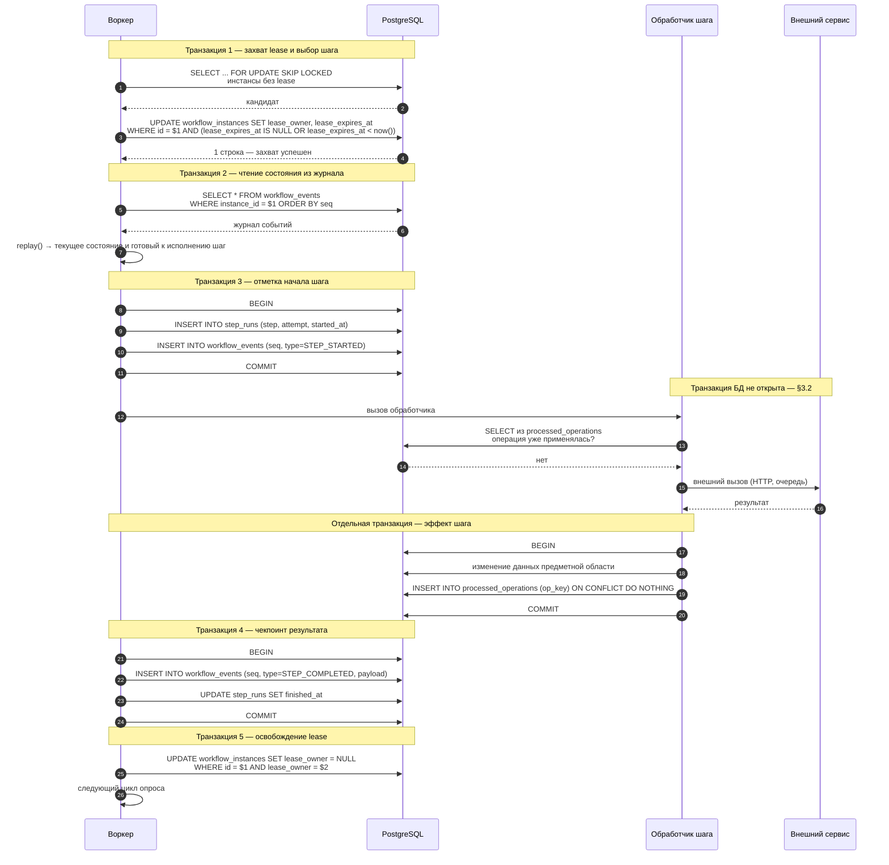
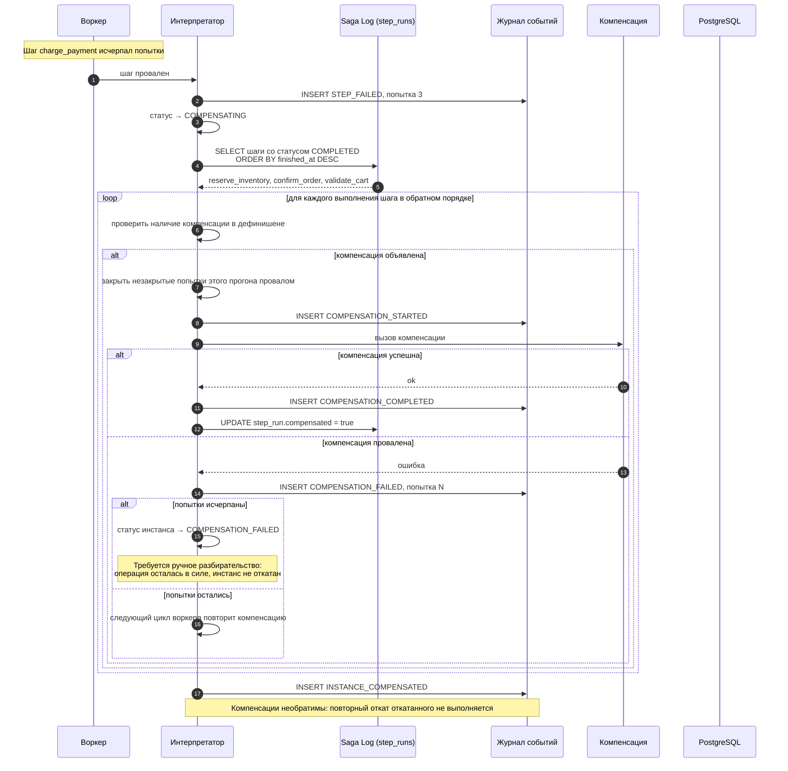
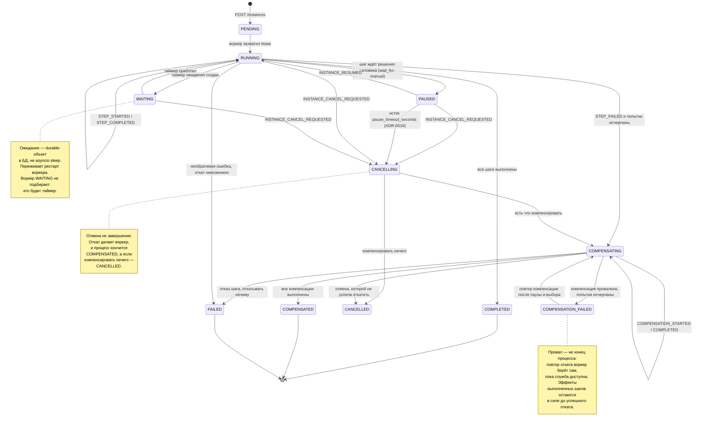

# Механизмы ядра

Как устроено исполнение workflow: журнал событий, интерпретатор, lease,
восстановление после падения, компенсации, идемпотентность, durable-таймеры.

Обоснование решений — в [`adr/`](adr/README.md). Здесь — механика.

---

## 1. Журнал событий

### 1.1 Назначение

Таблица `workflow_events` — единственный источник истины об инстансе. Текущее
состояние не хранится как готовый факт: оно выводится replay'ом журнала.

Причина не в экономии места. Запись события и изменение состояния происходят
в одной транзакции БД, поэтому событие всегда описывает уже применённое
изменение. Обратное — «состояние записали, событие забыли» — невозможно
конструктивно.

### 1.2 Append-only

На `workflow_events` запрещены `UPDATE` и `DELETE`. Событие — это факт о том,
что произошло; исправить факт нельзя, можно записать следующий.

Заодно снимается класс ошибок: не нужно различать «состояние актуально» и
«состояние записано в одном коммите с событием».

### 1.3 Монотонная последовательность

У каждого события есть `seq` — порядковый номер внутри инстанса. Он
выделяется под блокировкой строки инстанса, поэтому строго монотонен и не
имеет пропусков: конкурирующая запись ждёт, а не получает следующий номер.

`seq` делает replay детерминированным и позволяет ссылаться на конкретный
чекпоинт («продолжить с события 47»).

### 1.4 Состав событий

| Тип | Когда |
|---|---|
| `INSTANCE_CREATED` | создан инстанс |
| `INSTANCE_STARTED` | воркер захватил lease |
| `STEP_STARTED` | начало попытки исполнения шага |
| `STEP_COMPLETED` | шаг успешен |
| `STEP_FAILED` | попытка исчерпана или необратимая ошибка |
| `STEP_RETRY_SCHEDULED` | шаг поставлен на повтор |
| `TIMER_SCHEDULED` / `TIMER_FIRED` | ожидание создано / сработало |
| `COMPENSATION_STARTED` | начало компенсации |
| `COMPENSATION_COMPLETED` | компенсация успешна |
| `COMPENSATION_FAILED` | компенсация провалена либо попытка прервана |
| `INSTANCE_COMPLETED` | процесс завершён успешно |
| `INSTANCE_COMPENSATED` | откат завершён |
| `INSTANCE_FAILED` | отказ завершён без отката: упал шаг, откатывать нечему |
| `INSTANCE_CANCEL_REQUESTED` | запрошена отмена, откат ещё впереди |
| `INSTANCE_CANCELLED` | отмена завершена, компенсировать было нечего |
| `LEASE_EXPIRED` | lease протух, инстанс брошен |

Запрос отмены и её завершение разнесены по разным событиям. Пока это были
одно и то же событие, отменённый инстанс с выполненными шагами завершался с
ним сразу, минуя откат: резерв или списание оставались в силе навсегда.

### 1.5 Replay

```python
def replay(events: list[Event]) -> InstanceState:
    """Восстанавливает состояние инстанса по журналу.

    Чистая функция: ни БД, ни времени. Именно поэтому replay одинаков
    до и после падения воркера.
    """
```

Replay детерминирован и не обращается к внешним системам. Проверяется
свойством: повторный проход по тому же журналу даёт то же состояние.

---

## 2. Lease и взаимноисключающее исполнение

### 2.1 Что даёт lease

Требование: инстанс обрабатывается ровно одним воркером, но воркер может
умереть в любой момент. Классические блокировки не подходят: удержание
блокировки между шагами при падении процесса утекает навсегда.

Lease — аренда с временем. Воркер получает инстанс, если аренда свободна или
истекла, и обязан продлевать её heartbeat'ом во время работы.

### 2.2 Захват

```sql
UPDATE workflow_instances
SET lease_owner = :worker_id,
    lease_expires_at = now() + :ttl,
    heartbeat_at = now()
WHERE id = :instance_id
  AND (lease_expires_at IS NULL OR lease_expires_at < now())
RETURNING id
```

Ноль строк — инстанс занят. Кандидаты отбираются так:

```sql
SELECT id FROM workflow_instances
WHERE status IN ('RUNNING', 'COMPENSATING')
  AND lease_expires_at < now()
ORDER BY lease_expires_at
FOR UPDATE SKIP LOCKED
LIMIT :batch
```

`SKIP LOCKED` — ключевая часть: конкуренты не блокируют друг друга, а
пропускают занятые строки. Воркер N+1 сразу берёт следующий свободный инстанс.

Атомарность захвата обеспечивает именно `UPDATE` с условием, а не
`SELECT`-проверка с последующим `UPDATE`: между проверкой и записью другой
воркер успел бы занять инстанс.

### 2.3 Heartbeat

Во время исполнения шага воркер обновляет `heartbeat_at` и `lease_expires_at`
каждые `HEARTBEAT_INTERVAL_SECONDS`. Конфигурация валидирует, что интервал
строго меньше TTL — иначе живой воркер выглядит мёртвым.

### 2.4 Освобождение и потеря lease

```sql
UPDATE workflow_instances
SET lease_owner = NULL, lease_expires_at = NULL
WHERE id = :instance_id AND lease_owner = :worker_id
```

Условие по `lease_owner` обязательно: если lease уже перехвачен, старый воркер
не должен «освободить» чужую аренду и сбросить прогресс нового.

Потеря lease в середине шага обнаруживается на следующей операции записи:
`UPDATE` возвращает ноль строк → воркер прекращает работу с инстансом и
переходит к следующему.

---

## 3. Последовательность исполнения шага



Источник — [`diagrams/execution-sequence.mmd`](diagrams/execution-sequence.mmd).

Главное в этой схеме — транзакция закрывается **до** внешнего вызова. Между
моментом «шаг начался» и «шаг закончился» инстанс находится в состоянии,
которое можно воспроизвести по журналу, а не по соединению с БД.

---

## 4. Восстановление после падения воркера

```mermaid
sequenceDiagram
    autonumber
    participant W1 as Воркер 1 (жив)
    participant W2 as Воркер 2
    participant DB as PostgreSQL
    participant S as Внешний сервис

    W1->>DB: UPDATE ... SET lease_owner='w1', lease_expires_at=now()+30s
    DB-->>W1: захват
    W1->>W1: начало шага reserve_inventory
    W1->>S: внешний вызов (долгий)

    Note over W1: 💥 Воркер 1 убит (SIGKILL, OOM, падение узла)

    Note over W2: lease истёк — heartbeat не обновлялся дольше TTL

    W2->>DB: SELECT ... WHERE status IN (RUNNING, COMPENSATING)<br/>AND lease_expires_at < now() FOR UPDATE SKIP LOCKED
    DB-->>W2: брошенный инстанс
    W2->>DB: UPDATE ... SET lease_owner='w2', lease_expires_at=now()+30s
    DB-->>W2: захват

    W2->>DB: SELECT * FROM workflow_events ORDER BY seq
    DB-->>W2: журнал
    W2->>W2: replay() → последний чекпоинт

    Note over W2,DB: Шаг не был завершён — event STEP_COMPLETED отсутствует
    W2->>DB: SELECT * FROM processed_operations WHERE instance_id=$1 AND op_key=$2
    DB-->>W2: запись есть либо нет

    alt эффект шага уже применён (op_key найден)
        W2->>W2: шаг считается выполненным, пишем STEP_COMPLETED без повторного вызова
    else эффект не применён
        W2->>S: повторный внешний вызов
        S-->>W2: результат
    end

    W2->>DB: BEGIN; INSERT INTO workflow_events (STEP_COMPLETED); COMMIT
    Note over W2: Восстановление завершено: дублей нет, потерянных шагов нет
```

Источник — [`diagrams/recovery-sequence.mmd`](diagrams/recovery-sequence.mmd).

### Что даёт восстановление

| Ситуация | Результат |
|---|---|
| Воркер убит до захвата lease | Ничего не потеряно: инстанс не начат, его подхватит другой |
| Воркер убит после `STEP_STARTED` | Шаг повторяется; `processed_operations` не даст применить эффект дважды |
| Воркер убит после применения эффекта, до чекпоинта | Эффект уже учтён: `op_key` найден, шаг закроется без повторного вызова |
| Воркер убит после `STEP_COMPLETED` | Событие в журнале, шаг не исполняется заново |

### Время восстановления

Не быстрее TTL lease: до истечения `lease_expires_at` брошенный инстанс
считается занятым. Это осознанная плата за отсутствие распределённых
блокировок — система не может отличить «медленный воркер» от «мёртвого»
иначе, чем по времени молчания.

---

## 5. Интерпретатор

`app/engine/interpreter.py` — чистая логика переходов: ни БД, ни внешних
вызовов. Модуль сознательно ничего не знает про журнал и lease — это позволяет
проверять правила переходов обычными unit-тестами.

Обработчики демонстрационной предметной области. Все они асинхронные и
работают с данными: компенсация имеет смысл, только когда отменять есть что.

| Шаг | Обработчик | Что делает | Компенсация |
|---|---|---|---|
| `validate_cart` | `validate_cart` | Считает позиции | — |
| `reserve_inventory` | `reserve_inventory` | `demo_inventory.reserved += qty` | `release_inventory`: `reserved -= qty` |
| `charge_payment` | `charge_payment` | Запись в `demo_payments`, статус `HELD` | `refund_payment`: статус `REFUNDED` |
| `create_shipment` | `create_shipment` | Запись в `demo_shipments` | `cancel_shipment`: статус `CANCELLED` |
| `confirm_delivery` | `confirm_delivery` | Ничего: обратимость по умолчанию | — |

Обработчик применяет эффект через `idempotency.apply_once_by_key`: проверка
ключа, изменение и отметка операции идут **одной транзакцией**. Ключ приходит
в контексте как `operation_id`. Это и есть требование §3.4, применённое к
делу: падение воркера между действием и отметкой не приводит к повторному
списанию или повторному резерву.

Компенсация получает собственный ключ с префиксом `compensate:` — это другая
операция, и повтор шага не должен выглядеть как уже выполненная отмена.

Ограничение `reserved <= available` в таблице склада делает нехватку товара
ошибкой шага, а не тихой ошибкой приложения. Проверка в обработчике остаётся
тоже: она даёт оператору внятную причину, а не сообщение СУБД.

### 5.1 Переходы

- **Линейный** — `next` указывает на следующий шаг.
- **Условный** — `next` как объект `{"on_success": ..., "on_failure": ...}`;
  переход выбирается по результату шага. Исполняется.
- **Wait** — шаг с `wait_before_seconds` создаёт durable-таймер; исполнение
  продолжается после `TIMER_FIRED`.
- **Fork / join** — параллельные ветки. Схема их принимает, но **исполнение не
  реализовано**, и валидатор поэтому отвергает такие определения при
  сохранении: код ошибки `fork_not_executed` / `join_not_executed`.

  Отказ выбран вместо молчаливого полууспеха, при котором процесс
  отчитывался бы об успехе, выполнив только префикс графа. Причина и цена
  решения — [ADR-0008](adr/0008-parallelnye-vetki-otkaz.md).

### 5.2 Циклы

Цикл допускается только явным признаком `loop: true` **и** пределом
`max_iterations`. Валидация отвергает цикл без обоих: процесс, который
не знает, когда остановиться, не управляем в принципе.

Предел **применяется**. Счётчик проходов живёт в `InstanceState` и растёт на
каждом `STEP_COMPLETED` при replay — то есть состояние выводится из журнала,
и подхват воркера даёт тот же счётчик, что видел упавший. Ошибочный повтор
проходом не считается: он не завершает шаг.

По достижении предела пишется `LOOP_EXHAUSTED`, и процесс уходит в
компенсацию. Молча остановиться было бы хуже — неуспех выглядел бы как
успех; «провалить» шаг — значило бы записать в журнал ложь, ведь шаг-то
выполнен.

Счётчик отдаётся в `GET /api/instances/{id}/state` полем `step_iterations`:
интерфейс показывает по нему «проход 2 из 3».

### 5.3 Ошибки

| Ситуация | Решение интерпретатора | Событие |
|---|---|---|
| Попытка < `max_attempts` | Повтор шага с нарастающей задержкой | `STEP_RETRY_SCHEDULED` + `TIMER_SCHEDULED` |
| Попытки исчерпаны | Откат выполненных шагов |
| Ошибка `retryable = False` | Отказ без повтора: сразу в `STEP_FAILED` | `STEP_FAILED` с `terminal: true` |
| Указана ветка `on_failure` | Переход в неё | `STEP_FAILED` с `terminal: false` |
| Таймаут шага | Попытка засчитывается как неудача | `STEP_FAILED` |

Ошибка выше может быть постоянной: объявить на ней `retryable = False`, и иначе даже вообще не повторяться. В демо-обработке это `app.demo.handlers.reserve_inventory`: товар сам не появится, и `max_attempts` повторов только отдалял бы откат занятого резерва. Приоритет есть и у `app.engine.executor.PermanentStepError`.

Исчерпание попыток ведёт **в откат**, а не в остановку: выполненные шаги надо
вернуть, иначе процесс остаётся с частично применённым эффектом.

Переход по ветке `on_failure` едет в журнале полем `next` события `STEP_FAILED`.
Без него решение интерпретатора терялось: процесс возвращался на упавший шаг и
уходил в откат вместо объявленной ветки.

### 5.4 Sync и async обработчики

Обработчик может быть синхронным или асинхронным — определяется по результату
вызова, а не по объявлению. Практическое следствие: **таймаут применяется только
к async-обработчикам**. Синхронный обработчик блокирует event loop, и прервать
его извне нельзя, поэтому такие обработчики обязаны быть короткими.

---

## 6. Исполнение шага

`app/engine/executor.py` выполняет один шаг. Ключевое свойство — транзакция
закрывается **до** внешнего вызова.

### 6.1 Порядок операций

| Шаг | Транзакция | Что происходит |
|---|---|---|
| 1 | открыта | `STEP_STARTED`, строка `step_runs` со статусом `RUNNING` |
| 2 | **закрыта** | heartbeat продлевает аренду в фоновой задаче |
| 3 | **закрыта** | проверка `processed_operations`, вызов обработчика |
| 4 | открыта | `processed_operations` + результат шага |
| 5 | открыта | `STEP_COMPLETED` / `STEP_FAILED`, запись в `step_runs` |

Между шагами 1 и 3 транзакции нет. Именно поэтому падение в этот момент не
теряет работу: состояние восстанавливается replay'ом журнала.

### 6.2 Heartbeat во время шага

Пока выполняется шаг, работает фоновая задача, продлевающая аренду каждые
`HEARTBEAT_INTERVAL_SECONDS`. Без неё шаг длиннее TTL признаётся брошенным, и
его начнёт другой воркер — то есть работа выполнится дважды.

Задача завершается в `finally`: утечка фоновой задачи при каждом шаге съела бы
память воркера за сутки работы.

### 6.3 Повтор шага

Номер попытки берётся из `step_runs`, а не из памяти воркера. После перезапуска
счётчик обязан продолжиться, иначе процесс зациклится на первой попытке и
бесконечно повторял бы шаг.

---

## 7. Цикл воркера

`app/worker.py`, функция `run_cycle`:

1. разбуждение инстансов, чьи таймеры сработали (`fire_due`);
2. `claim_next` — подбор инстанса и захват аренды одним `UPDATE`;
3. `replay` журнала — восстановление состояния;
4. решение: компенсация / завершение / ожидание / исполнение шага;
5. освобождение аренды **всегда**, независимо от результата.

Последний пункт существенен: удержание аренды после шага означало бы ожидание
до истечения TTL перед следующим шагом, а после неудачи — перед откатом.

Первый пункт идёт **до** подбора, а не в ветке «делать нечего». Иначе
разбуждение происходило бы только в те циклы, когда очередь пуста, а процесс с
несработавшим таймером занимал бы подбор и не давал дойти до проверки таймеров.

Разбуждение и подбор идут разными транзакциями: `fire_due` берёт строку
инстанса под блокировкой, а `claim_next` выбирает кандидатов через
`FOR UPDATE SKIP LOCKED` — в одной транзакции он пропустил бы строку, которую
только что обновил, и проснувшийся инстанс ждал бы ещё одного цикла.

### 7.1 Кто обслуживает спящий инстанс

`claim_next` **не** выбирает инстансы в статусе `WAITING`. Их обслуживает
таймер: получив срок, он пишет `TIMER_FIRED`, возвращает инстанс в `RUNNING`,
и только тогда инстанс снова попадает в подбор.

Если бы `WAITING` попадал в выборку, воркер брал бы один и тот же спящий
инстанс, пока тот не проснётся, и вся очередь за ним стояла бы.

### 7.2 Определение завершения

Инстанс без готового шага при нетерминальном статусе означает, что граф дошёл
до конца: событие `INSTANCE_COMPLETED`. Трактовка «нужен откат» здесь была бы
ошибкой — компенсировать нечего.

---

## 8. Saga и компенсации



Источник — [`diagrams/compensation-sequence.mmd`](diagrams/compensation-sequence.mmd).

### 8.1 Правила

1. **Обратный порядок.** Компенсации идут от последнего выполнения к первому:
   внутри шага строго, свежий прогон первым. Между шагами порядок берётся из
   журнала, и шаги идут подряд: разбор хранит выполненные шаги без повторов,
   поэтому строгий обратный порядок по проходам цикла недоступен (§9.2).
2. **Только выполненное.** Компенсируется то, что действительно выполнено, и по
   прогонам, а не по именам шагов: шаг цикла выполнен несколько раз, и каждое
   выполнение отменяется отдельно. Упавший шаг не оставил эффекта и компенсации
   не требует.
3. **Необратимость.** Компенсацию нельзя «компенсировать компенсацией». Она
   либо успешна, либо нет.
4. **Идемпотентность.** Повтор компенсации после сбоя обязан быть безопасным;
   ключ строится как `{instance}:compensate:{шаг}:{прогон}`, пишется в
   `processed_operations` и намеренно отличается от ключа основного шага,
   иначе откат был бы признан уже применённым. Номер попытки в ключ не входит:
   операция одна, и падение между эффектом и отметкой вернуло бы средства второй
   раз. Прогон входит — по имени шага все проходы цикла получили бы один ключ,
   и вторая компенсация объявила бы «уже применено», не отменив ничего.
5. **Видимость сбоя.** `COMPENSATION_FAILED` — это состояние, требующее
   ручного разбирательства, а не тихий сбой.
6. **Счётчик попыток в БД.** Число попыток берётся из `compensation_log`, а не
   из памяти воркера: после перезапуска иначе откат зациклился бы.

### 8.2 Почему компенсация может провалиться

Компенсация обращается к внешнему миру и потому может не получиться: сервис
недоступен, данные уже изменились, валидация не проходит. Система обязана
отличать «откат не удался» от «откат удался» — иначе инстанс будет считаться
приведённым в исходное состояние, хотя это не так. Отсюда `COMPENSATION_FAILED`
и обязательная видимость этой ситуации в интерфейсе.

---

## 9. Идемпотентность

### 9.1 Правило

Обработчик сначала спрашивает `processed_operations`, и только потом применяет
эффект. Обратный порядок даёт дубль: проверка после действия ничего не
защищает.

### 9.2 Ключ операции

`op_key` однозначно определяет операцию: `{instance_id}:{step_name}:{attempt}`.
Номер попытки в ключе обязателен — иначе повтор после падения воркера был бы
признан уже применённым и шаг не выполнился бы никогда.

Для внешних вызовов наружу передаётся тот же ключ — иначе повторный вызов
внешнего сервиса продублирует операцию в чужой системе.

План отката строится по журналу, а не по колонке инстанса. Колонка стоит за шагом, выполненным в текущей итерации: отмена, пришедшая в той же итерации, ещё не учтена в ней, и план отката выродился бы пустым, хотя резерв уже занят. Воркер берёт порядок из `replay` (§3.1) и передаёт `state.completed_steps` в `saga.plan`.

Порядок задаёт только очерёдность шагов, а число отменяемых выполнений приходит из
`step_runs`. Это различение обязательно: шаг в цикле выполняется несколько раз, и
каждое выполнение откатывается отдельно. План берёт все неоткатанные прогоны шага,
свежие сверху, поэтому повтор внутри шага идёт в обратном порядке, а группировка по
шагу — то следствие, что разбор журнала хранит выполненные шаги без повторов.

Компенсация записывается в ту же таблицу под именем
`compensate:{step_name}:{step_run_id}`: откат проходит по тем же правилам, что и прямой
шаг. Без этого повтор компенсации после падения воркера вернул бы средства
дважды — а компенсация по определению необратима и повторяться не должна. Идентификатор
прогона в ключе обязателен по другой причине: без него все проходы цикла получили бы
один ключ, и второй возврат прошёл бы как «уже применено» — с успехом и без отмены.
Ключ строит `saga.operation_key`, и обработчик получает его же в
`ctx.operation_id`: формат, записанный в двух местах, однажды разошёлся именно так.

### 9.4 Два слоя отметки, а не одна

Отметка показывается дважды, и это не дублирование:

- обработчик отмечает операцию **в своей транзакции** (`apply_once_by_key`) — эффект и
  отметка пишутся вместе: падение между ними невозможно;
- движок после вызова шага сначала проверяет `already_applied(...)` и потом метит
  `mark_applied(...)`. Это страховка для обработчиков без своего хранилища: внешний
  вызов, ушедший без внешней отметки, повторился бы, и резерв остался бы занят.

Поэтому вторая отметка — нооп: `mark_applied` возвращает `False`. Отдельный маркер не
нужен: события повторялись бы, путая событийная лента.

### 9.3 Insert-first как альтернатива

Порой ключ записывается **до** действия, в одной транзакции с намерением.
Применяется, когда действие необратимо и идемпотентный внешний ключ передать
нельзя. Цена: падение между записью ключа и действием приводит к «потерянной»
операции, которая никогда не выполнится. Выбор между двумя подходами
фиксируется обработчиком явно, а не по умолчанию.

---

## 10. Durable-таймеры

Ожидание — объект в БД (`timers`), а не `asyncio.sleep`:

- переживает рестарт воркера;
- выдерживает падение узла;
- позволяет нескольким воркерам конкурировать за один таймер через те же
  `SKIP LOCKED` и lease.

```sql
SELECT id FROM timers
WHERE fired = false AND due_at <= now()
ORDER BY due_at
FOR UPDATE SKIP LOCKED
LIMIT :batch
```

### 10.1 Срабатывание — одна транзакция

Срабатывание состоит из трёх вещей, и они обязаны быть в одной транзакции:

1. отметка `fired = true`;
2. событие `TIMER_FIRED` в журнале;
3. возврат статуса инстанса в `RUNNING`.

Расхождение между ними — не «редкий случай», а зависание навсегда:

- отметка без события — таймер сгорел, `replay` ничего не увидит, инстанс
  останется в `WAITING`;
- событие без отметки — таймер будет сработать повторно и разбудит уже
  завершённый процесс;
- событие без смены статуса в колонке — инстанс вернётся в `RUNNING` по
  журналу, но `claim_next` его не подберёт, потому что смотрит на колонку.

Поэтому подбор таймеров (`claim_due`) **не** помечает их сгоревшими: это
делает `fire_due` вместе с событием. Падение воркера между подбором и
срабатыванием тогда просто приводит к повторной обработке.

### 10.2 Ожидание планируется один раз

`wait_before_seconds` у шага означает паузу **перед** шагом, и она ожидает
один раз. Перед планированием проверяется, не было ли ожидание уже заведено
для этого шага инстанса (`planned_for`) — причём учитываются и сгоревшие
таймеры.

Без такой проверки воркер заводил бы новый таймер на каждом цикле, и шаг с
ожиданием не наступил бы никогда. Обратная ошибка — проверять только
несгоревшие таймеры: тогда после срабатывания шаг завёл бы новую паузу и
исполнялся бы бесконечно.

Само ожидание планируется **до** открытия транзакции шага: так пауза
переживает рестарт, а запись таймера и события `TIMER_SCHEDULED` идут вместе.

Память процесса в учёте ожиданий не участвует.

### 10.3 Срок ожидания человека

Шаг с `wait_for: manual` может объявить `pause_timeout_seconds`. По умолчанию
срока нет, и пауза живёт, пока придёт команда возобновления.

Срок — тот же durable-таймер, но с видом `pause_deadline`. Вид обязателен:
на шаге могут стоять и ожидание, и срок, и без различия `planned_for` принял
бы одно за другое.

По истечении срока пишется `INSTANCE_CANCEL_REQUESTED`, и процесс уходит в
существующий путь отката. Продолжение шага было бы соблазнительно, но
действие шага необратимо: для ворот согласования «не получил ответа за срок —
значит, платим» означает платить без согласования.

Планируется срок в той же транзакции, что и `INSTANCE_PAUSED`. Без этого
пауза осталась бы без будильника: `PAUSED` исключён из подбора воркером,
и разбудить её было бы некому.

---

## 11. Машина состояний инстанса



Источник — [`diagrams/instance-states.mmd`](diagrams/instance-states.mmd).

---

## 12. Отказоустойчивость: сводка

| Отказ | Обнаружение | Реакция |
|---|---|---|
| Воркер убит | Истёк lease | Другой воркер подхватывает с чекпоинта |
| Шаг провалился | Исключение или таймаут | Повтор до `STEP_MAX_ATTEMPTS`, затем компенсация |
| Lease потерян посреди шага | `UPDATE` вернул 0 строк | Прекратить работу с инстансом |
| Внешний сервис недоступен | Ошибка вызова | Повтор с нарастающей задержкой |
| Сервис «завис» | Таймаут шага | Повтор; эффект защищён `processed_operations` |
| Компенсация провалена | Исключение | Повтор до исчерпания, затем `COMPENSATION_FAILED` |
| Инстанс брошен с `COMPENSATING` | Истёк lease | Откат продолжается с места остановки |
| Утраченное событие | Невозможно | Append-only и одна транзакция на событие исключают |

---

## 13. Что проверено тестами

| Свойство | Тест |
|---|---|
| Процесс проходит дефинишен целиком | `tests/integration/test_execution.py::test_instance_completes_end_to_end` |
| Шаги выполняются в порядке графа | `::test_all_steps_executed_in_order` |
| Выход шага попадает в переменные | `::test_step_outputs_become_variables` |
| Тайминги пишутся в `step_runs` | `::test_step_runs_record_timings` |
| Аренда освобождается после шага | `::test_lease_is_released_after_completion` |
| Сбой шага приводит к откату | `::test_failed_step_triggers_compensation` |
| Откат идёт в обратном порядке | `::test_compensation_covers_only_completed_steps` |
| Провал компенсации виден как `COMPENSATION_FAILED` | `::test_failed_compensation_is_visible` |
| Провал компенсации повторяется без исполнения упавшего шага | `::test_compensation_retries_after_failure` |
| Повтор отката не откатывает уже сделанный шаг | `::test_retry_does_not_repeat_finished_compensation` |
| После перехвата нет дублей шагов | `::test_resumed_worker_does_not_duplicate_steps` |
| Replay после паузы совпадает с непрерывным проходом | `::test_replay_after_pause_matches_continuous_run` |
| Два воркера не выполняют один шаг | `::test_two_workers_do_not_execute_same_step` |
| Регистрация операции откатывается с транзакцией | `tests/integration/test_idempotency.py::test_registration_is_rolled_back_with_transaction` |
| Перехват истёкшей аренды другим воркером | `tests/chaos/test_worker_crash.py::test_expired_lease_is_taken_over_by_another_worker` |
| Живая аренда блокирует перехват | `::test_process_killed_mid_step_is_recovered` |
| Heartbeat чаще TTL | `::test_lease_ttl_is_shorter_than_timeout_guard` |
| Объявленное ожидание становится таймером в БД | `tests/integration/test_durable_timers.py::test_declared_wait_is_scheduled_not_executed` |
| Шаг после ожидания не исполняется до срока | `::test_waiting_step_is_not_executed_before_timer` |
| Ожидание не заводится повторно | `::test_waiting_step_does_not_create_second_timer` |
| Сработавший таймер будит инстанс | `::test_due_timer_wakes_instance` |
| Срабатывание пишет `TIMER_FIRED` | `::test_fired_timer_writes_event` |
| Таймер срабатывает ровно один раз | `::test_timer_is_fired_only_once` |
| Спящий инстанс не занимает подбор | `::test_pending_timer_does_not_block_other_instances` |
| Таймеры срабатывают при пустой очереди | `::test_timers_fire_without_new_instances` |
| Спящий инстанс не берётся в подбор | `tests/integration/test_lease.py::test_claim_next_skips_waiting_instance` |
| Проснувшийся инстанс снова доступен | `::test_woken_instance_becomes_claimable_again` |
| Отметка и событие идут одной транзакцией | `tests/integration/test_saga_and_timers.py::test_fire_due_is_skipped_when_already_fired` |
| Ветка `on_success` исполняется | `tests/integration/test_execution.py::test_on_success_branch_is_taken` |
| Ветка `on_failure` исполняется, а не уходит в откат | `::test_on_failure_branch_is_taken` |
| Без объявленной ветки сбой ведёт в откат | `::test_branch_without_on_failure_goes_to_compensation` |
| Цикл останавливается на объявленном пределе | `::test_loop_stops_at_declared_limit` |
| Число проходов цикла равно пределу | `::test_loop_runs_declared_number_of_passes` |
| Исчерпание предела записано в журнал | `::test_loop_exhaustion_is_written_to_journal` |
| Счётчик проходов переживает смену воркера | `::test_loop_limit_survives_worker_restart` |
| Ошибочный повтор не считается проходом | `tests/integration/test_journal.py::test_failed_step_does_not_count_as_iteration` |
| Исчерпание цикла ведёт в компенсацию | `::test_loop_exhausted_moves_to_compensation` |
| Определение с ветвями отвергается | `tests/unit/test_definition_validation.py::test_fork_is_rejected_as_not_executed` |
| Раскладка схемы считает слои и обрывает цикл | `frontend/src/lib/graphLayout.test.ts` (10 тестов) |
| Цвет узла отражает факт, а не статус процесса | `frontend/src/lib/graphState.test.ts` |