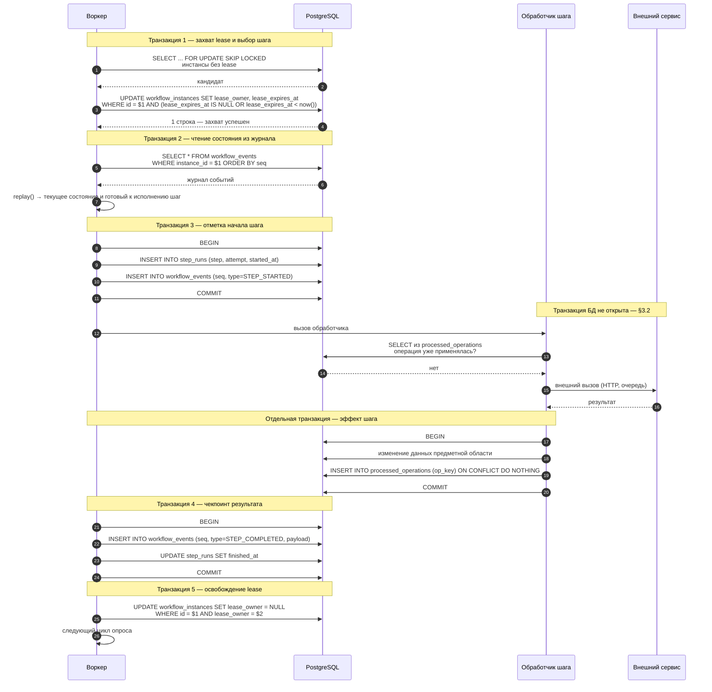
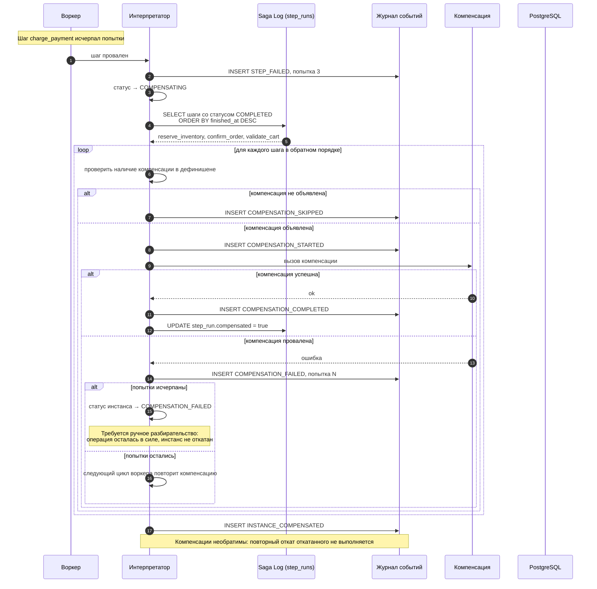
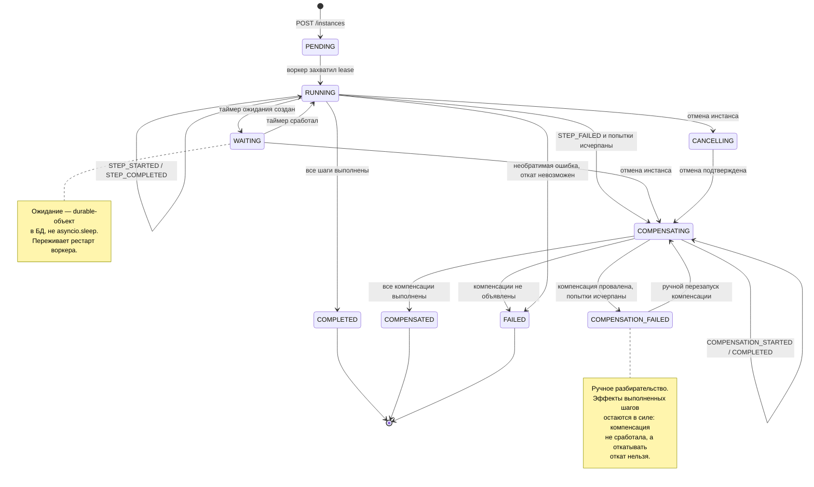

# Механизмы ядра

Как устроено исполнение workflow: журнал событий, интерпретатор, lease,
восстановление после падения, компенсации, идемпотентность, durable-таймеры.

Обоснование решений — в [`adr/`](adr/README.md). Здесь — механика.

---

## 1. Журнал событий

### 1.1 Назначение

Таблица `workflow_events` — единственный источник истины об инстансе. Текущее
состояние не хранится как готовый факт: оно выводится replay'ом журнала.

Причина не в экономии места. Запись события и изменение состояния происходят
в одной транзакции БД, поэтому событие всегда описывает уже применённое
изменение. Обратное — «состояние записали, событие забыли» — невозможно
конструктивно.

### 1.2 Append-only

На `workflow_events` запрещены `UPDATE` и `DELETE`. Событие — это факт о том,
что произошло; исправить факт нельзя, можно записать следующий.

Заодно снимается класс ошибок: не нужно различать «состояние актуально» и
«состояние записано в одном коммите с событием».

### 1.3 Монотонная последовательность

У каждого события есть `seq` — порядковый номер внутри инстанса. Он
выделяется под блокировкой строки инстанса, поэтому строго монотонен и не
имеет пропусков: конкурирующая запись ждёт, а не получает следующий номер.

`seq` делает replay детерминированным и позволяет ссылаться на конкретный
чекпоинт («продолжить с события 47»).

### 1.4 Состав событий

| Тип | Когда |
|---|---|
| `INSTANCE_CREATED` | создан инстанс |
| `INSTANCE_STARTED` | воркер захватил lease |
| `STEP_STARTED` | начало попытки исполнения шага |
| `STEP_COMPLETED` | шаг успешен |
| `STEP_FAILED` | попытка исчерпана или необратимая ошибка |
| `STEP_RETRY_SCHEDULED` | шаг поставлен на повтор |
| `TIMER_SCHEDULED` / `TIMER_FIRED` | ожидание создано / сработало |
| `COMPENSATION_STARTED` | начало компенсации |
| `COMPENSATION_COMPLETED` | компенсация успешна |
| `COMPENSATION_FAILED` | компенсация провалена |
| `COMPENSATION_SKIPPED` | компенсация не объявлена |
| `INSTANCE_COMPLETED` | процесс завершён успешно |
| `INSTANCE_COMPENSATED` | откат завершён |
| `INSTANCE_CANCELLED` | отмена инстанса |
| `LEASE_EXPIRED` | lease протух, инстанс брошен |

### 1.5 Replay

```python
def replay(events: list[Event]) -> InstanceState:
    """Восстанавливает состояние инстанса по журналу.

    Чистая функция: ни БД, ни времени. Именно поэтому replay одинаков
    до и после падения воркера.
    """
```

Replay детерминирован и не обращается к внешним системам. Проверяется
свойством: повторный проход по тому же журналу даёт то же состояние.

---

## 2. Lease и взаимноисключающее исполнение

### 2.1 Что даёт lease

Требование: инстанс обрабатывается ровно одним воркером, но воркер может
умереть в любой момент. Классические блокировки не подходят: удержание
блокировки между шагами при падении процесса утекает навсегда.

Lease — аренда с временем. Воркер получает инстанс, если аренда свободна или
истекла, и обязан продлевать её heartbeat'ом во время работы.

### 2.2 Захват

```sql
UPDATE workflow_instances
SET lease_owner = :worker_id,
    lease_expires_at = now() + :ttl,
    heartbeat_at = now()
WHERE id = :instance_id
  AND (lease_expires_at IS NULL OR lease_expires_at < now())
RETURNING id
```

Ноль строк — инстанс занят. Кандидаты отбираются так:

```sql
SELECT id FROM workflow_instances
WHERE status IN ('RUNNING', 'COMPENSATING')
  AND lease_expires_at < now()
ORDER BY lease_expires_at
FOR UPDATE SKIP LOCKED
LIMIT :batch
```

`SKIP LOCKED` — ключевая часть: конкуренты не блокируют друг друга, а
пропускают занятые строки. Воркер N+1 сразу берёт следующий свободный инстанс.

Атомарность захвата обеспечивает именно `UPDATE` с условием, а не
`SELECT`-проверка с последующим `UPDATE`: между проверкой и записью другой
воркер успел бы занять инстанс.

### 2.3 Heartbeat

Во время исполнения шага воркер обновляет `heartbeat_at` и `lease_expires_at`
каждые `HEARTBEAT_INTERVAL_SECONDS`. Конфигурация валидирует, что интервал
строго меньше TTL — иначе живой воркер выглядит мёртвым.

### 2.4 Освобождение и потеря lease

```sql
UPDATE workflow_instances
SET lease_owner = NULL, lease_expires_at = NULL
WHERE id = :instance_id AND lease_owner = :worker_id
```

Условие по `lease_owner` обязательно: если lease уже перехвачен, старый воркер
не должен «освободить» чужую аренду и сбросить прогресс нового.

Потеря lease в середине шага обнаруживается на следующей операции записи:
`UPDATE` возвращает ноль строк → воркер прекращает работу с инстансом и
переходит к следующему.

---

## 3. Последовательность исполнения шага



Источник — [`diagrams/execution-sequence.mmd`](diagrams/execution-sequence.mmd).

Главное в этой схеме — транзакция закрывается **до** внешнего вызова. Между
моментом «шаг начался» и «шаг закончился» инстанс находится в состоянии,
которое можно воспроизвести по журналу, а не по соединению с БД.

---

## 4. Восстановление после падения воркера

```mermaid
sequenceDiagram
    autonumber
    participant W1 as Воркер 1 (жив)
    participant W2 as Воркер 2
    participant DB as PostgreSQL
    participant S as Внешний сервис

    W1->>DB: UPDATE ... SET lease_owner='w1', lease_expires_at=now()+30s
    DB-->>W1: захват
    W1->>W1: начало шага reserve_inventory
    W1->>S: внешний вызов (долгий)

    Note over W1: 💥 Воркер 1 убит (SIGKILL, OOM, падение узла)

    Note over W2: lease истёк — heartbeat не обновлялся дольше TTL

    W2->>DB: SELECT ... WHERE status IN (RUNNING, COMPENSATING)<br/>AND lease_expires_at < now() FOR UPDATE SKIP LOCKED
    DB-->>W2: брошенный инстанс
    W2->>DB: UPDATE ... SET lease_owner='w2', lease_expires_at=now()+30s
    DB-->>W2: захват

    W2->>DB: SELECT * FROM workflow_events ORDER BY seq
    DB-->>W2: журнал
    W2->>W2: replay() → последний чекпоинт

    Note over W2,DB: Шаг не был завершён — event STEP_COMPLETED отсутствует
    W2->>DB: SELECT * FROM processed_operations WHERE instance_id=$1 AND op_key=$2
    DB-->>W2: запись есть либо нет

    alt эффект шага уже применён (op_key найден)
        W2->>W2: шаг считается выполненным, пишем STEP_COMPLETED без повторного вызова
    else эффект не применён
        W2->>S: повторный внешний вызов
        S-->>W2: результат
    end

    W2->>DB: BEGIN; INSERT INTO workflow_events (STEP_COMPLETED); COMMIT
    Note over W2: Восстановление завершено: дублей нет, потерянных шагов нет
```

Источник — [`diagrams/recovery-sequence.mmd`](diagrams/recovery-sequence.mmd).

### Что даёт восстановление

| Ситуация | Результат |
|---|---|
| Воркер убит до захвата lease | Ничего не потеряно: инстанс не начат, его подхватит другой |
| Воркер убит после `STEP_STARTED` | Шаг повторяется; `processed_operations` не даст применить эффект дважды |
| Воркер убит после применения эффекта, до чекпоинта | Эффект уже учтён: `op_key` найден, шаг закроется без повторного вызова |
| Воркер убит после `STEP_COMPLETED` | Событие в журнале, шаг не исполняется заново |

### Время восстановления

Не быстрее TTL lease: до истечения `lease_expires_at` брошенный инстанс
считается занятым. Это осознанная плата за отсутствие распределённых
блокировок — система не может отличить «медленный воркер» от «мёртвого»
иначе, чем по времени молчания.

---

## 5. Интерпретатор

`app/engine/interpreter.py` — чистая логика переходов: ни БД, ни внешних
вызовов. Модуль сознательно ничего не знает про журнал и lease — это позволяет
проверять правила переходов обычными unit-тестами.

Обработчики демонстрационной предметной области:

| Шаг | Обработчик | Компенсация |
|---|---|---|
| `validate_cart` | `demo/handlers.py:validate_cart` | — |
| `reserve_inventory` | `demo/handlers.py:reserve_inventory` | `demo/handlers.py:release_inventory` |
| `charge_payment` | `demo/handlers.py:charge_payment` | `demo/handlers.py:refund_payment` |
| `create_shipment` | `demo/handlers.py:create_shipment` | `demo/handlers.py:cancel_shipment` |
| `confirm_delivery` | `demo/handlers.py:confirm_delivery` | — |

### 5.1 Переходы

- **Линейный** — `next` указывает на следующий шаг.
- **Условный** — результат шага (`success` / `failure`) выбирает ветку.
- **Fork / join** — параллельные ветки расходятся после fork и сходятся в join.
- **Wait** — шаг создаёт durable-таймер; исполнение продолжается после
  `TIMER_FIRED`.

### 5.2 Циклы

Цикл допускается только явным признаком `loop: true` **и** пределом
`max_iterations`. Валидация отвергает цикл без обоих: процесс, который
не знает, когда остановиться, не управляем в принципе.

### 5.3 Ошибки

| Ситуация | Решение интерпретатора | Событие |
|---|---|---|
| Попытка < `max_attempts` | Повтор шага с нарастающей задержкой | `STEP_RETRY_SCHEDULED` + `TIMER_SCHEDULED` |
| Попытки исчерпаны | Откат выполненных шагов | `STEP_FAILED` с `terminal: true` |
| Указана ветка `on_failure` | Переход в неё | `STEP_FAILED` с `terminal: false` |
| Таймаут шага | Попытка засчитывается как неудача | `STEP_FAILED` |

Исчерпание попыток ведёт **в откат**, а не в остановку: выполненные шаги надо
вернуть, иначе процесс остаётся с частично применённым эффектом.

### 5.4 Sync и async обработчики

Обработчик может быть синхронным или асинхронным — определяется по результату
вызова, а не по объявлению. Практическое следствие: **таймаут применяется только
к async-обработчикам**. Синхронный обработчик блокирует event loop, и прервать
его извне нельзя, поэтому такие обработчики обязаны быть короткими.

---

## 6. Исполнение шага

`app/engine/executor.py` выполняет один шаг. Ключевое свойство — транзакция
закрывается **до** внешнего вызова.

### 6.1 Порядок операций

| Шаг | Транзакция | Что происходит |
|---|---|---|
| 1 | открыта | `STEP_STARTED`, строка `step_runs` со статусом `RUNNING` |
| 2 | **закрыта** | heartbeat продлевает аренду в фоновой задаче |
| 3 | **закрыта** | проверка `processed_operations`, вызов обработчика |
| 4 | открыта | `processed_operations` + результат шага |
| 5 | открыта | `STEP_COMPLETED` / `STEP_FAILED`, запись в `step_runs` |

Между шагами 1 и 3 транзакции нет. Именно поэтому падение в этот момент не
теряет работу: состояние восстанавливается replay'ом журнала.

### 6.2 Heartbeat во время шага

Пока выполняется шаг, работает фоновая задача, продлевающая аренду каждые
`HEARTBEAT_INTERVAL_SECONDS`. Без неё шаг длиннее TTL признаётся брошенным, и
его начнёт другой воркер — то есть работа выполнится дважды.

Задача завершается в `finally`: утечка фоновой задачи при каждом шаге съела бы
память воркера за сутки работы.

### 6.3 Повтор шага

Номер попытки берётся из `step_runs`, а не из памяти воркера. После перезапуска
счётчик обязан продолжиться, иначе процесс зациклится на первой попытке и
бесконечно повторял бы шаг.

---

## 7. Цикл воркера

`app/worker.py`, функция `run_cycle`:

1. `claim_next` — подбор инстанса и захват аренды одним `UPDATE`;
2. `replay` журнала — восстановление состояния;
3. решение: компенсация / завершение / ожидание / исполнение шага;
4. освобождение аренды **всегда**, независимо от результата.

Последний пункт существенен: удержание аренды после шага означало бы ожидание
до истечения TTL перед следующим шагом, а после неудачи — перед откатом.

### 7.1 Определение завершения

Инстанс без готового шага при нетерминальном статусе означает, что граф дошёл
до конца: событие `INSTANCE_COMPLETED`. Трактовка «нужен откат» здесь была бы
ошибкой — компенсировать нечего.

---

## 8. Saga и компенсации



Источник — [`diagrams/compensation-sequence.mmd`](diagrams/compensation-sequence.mmd).

### 8.1 Правила

1. **Обратный порядок.** Компенсации идут от последнего успешного шага к
   первому — зависимости между шагами зеркальны.
2. **Только завершённые шаги.** Компенсируется то, что действительно
   выполнено; факт берётся из `step_runs`, а не из предположения по журналу.
   Упавший шаг не оставил эффекта и компенсации не требует.
3. **Необратимость.** Компенсацию нельзя «компенсировать компенсацией». Она
   либо успешна, либо нет.
4. **Идемпотентность.** Повтор компенсации после сбоя обязан быть безопасным;
   ключ строится как `{instance}:compensate:{шаг}:{попытка}` — он намеренно
   отличается от ключа основного шага, иначе откат был бы признан уже
   применённым.
5. **Видимость сбоя.** `COMPENSATION_FAILED` — это состояние, требующее
   ручного разбирательства, а не тихий сбой.
6. **Счётчик попыток в БД.** Число попыток берётся из `compensation_log`, а не
   из памяти воркера: после перезапуска иначе откат зациклился бы.

### 8.2 Почему компенсация может провалиться

Компенсация обращается к внешнему миру и потому может не получиться: сервис
недоступен, данные уже изменились, валидация не проходит. Система обязана
отличать «откат не удался» от «откат удался» — иначе инстанс будет считаться
приведённым в исходное состояние, хотя это не так. Отсюда `COMPENSATION_FAILED`
и обязательная видимость этой ситуации в интерфейсе.

---

## 9. Идемпотентность

### 9.1 Правило

Обработчик сначала спрашивает `processed_operations`, и только потом применяет
эффект. Обратный порядок даёт дубль: проверка после действия ничего не
защищает.

### 9.2 Ключ операции

`op_key` однозначно определяет операцию: `{instance_id}:{step_name}:{attempt}`.
Номер попытки в ключе обязателен — иначе повтор после падения воркера был бы
признан уже применённым и шаг не выполнился бы никогда.

Для внешних вызовов наружу передаётся тот же ключ — иначе повторный вызов
внешнего сервиса продублирует операцию в чужой системе.

### 9.3 Insert-first как альтернатива

Порой ключ записывается **до** действия, в одной транзакции с намерением.
Применяется, когда действие необратимо и идемпотентный внешний ключ передать
нельзя. Цена: падение между записью ключа и действием приводит к «потерянной»
операции, которая никогда не выполнится. Выбор между двумя подходами
фиксируется обработчиком явно, а не по умолчанию.

---

## 10. Durable-таймеры

Ожидание — объект в БД (`timers`), а не `asyncio.sleep`:

- переживает рестарт воркера;
- выдерживает падение узла;
- позволяет нескольким воркерам конкурировать за один таймер через те же
  `SKIP LOCKED` и lease.

```sql
SELECT id FROM timers
WHERE fired = false AND due_at <= now()
ORDER BY due_at
FOR UPDATE SKIP LOCKED
LIMIT :batch
```

Срабатывание пишет `TIMER_FIRED` в журнал и освобождает инстанс для
продолжения. Память процесса не участвует в учёте ожиданий.

---

## 11. Машина состояний инстанса



Источник — [`diagrams/instance-states.mmd`](diagrams/instance-states.mmd).

---

## 12. Отказоустойчивость: сводка

| Отказ | Обнаружение | Реакция |
|---|---|---|
| Воркер убит | Истёк lease | Другой воркер подхватывает с чекпоинта |
| Шаг провалился | Исключение или таймаут | Повтор до `STEP_MAX_ATTEMPTS`, затем компенсация |
| Lease потерян посреди шага | `UPDATE` вернул 0 строк | Прекратить работу с инстансом |
| Внешний сервис недоступен | Ошибка вызова | Повтор с нарастающей задержкой |
| Сервис «завис» | Таймаут шага | Повтор; эффект защищён `processed_operations` |
| Компенсация провалена | Исключение | Повтор до исчерпания, затем `COMPENSATION_FAILED` |
| Инстанс брошен с `COMPENSATING` | Истёк lease | Откат продолжается с места остановки |
| Утраченное событие | Невозможно | Append-only и одна транзакция на событие исключают |

---

## 13. Что проверено тестами

| Свойство | Тест |
|---|---|
| Процесс проходит дефинишен целиком | `tests/integration/test_execution.py::test_instance_completes_end_to_end` |
| Шаги выполняются в порядке графа | `::test_all_steps_executed_in_order` |
| Выход шага попадает в переменные | `::test_step_outputs_become_variables` |
| Тайминги пишутся в `step_runs` | `::test_step_runs_record_timings` |
| Аренда освобождается после шага | `::test_lease_is_released_after_completion` |
| Сбой шага приводит к откату | `::test_failed_step_triggers_compensation` |
| Откат идёт в обратном порядке | `::test_compensation_covers_only_completed_steps` |
| Провал компенсации виден как `COMPENSATION_FAILED` | `::test_failed_compensation_is_visible` |
| После перехвата нет дублей шагов | `::test_resumed_worker_does_not_duplicate_steps` |
| Replay после паузы совпадает с непрерывным проходом | `::test_replay_after_pause_matches_continuous_run` |
| Два воркера не выполняют один шаг | `::test_two_workers_do_not_execute_same_step` |
| Регистрация операции откатывается с транзакцией | `tests/integration/test_idempotency.py::test_registration_is_rolled_back_with_transaction` |
| Перехват истёкшей аренды другим воркером | `tests/chaos/test_worker_crash.py::test_expired_lease_is_taken_over_by_another_worker` |
| Живая аренда блокирует перехват | `::test_process_killed_mid_step_is_recovered` |
| Heartbeat чаще TTL | `::test_lease_ttl_is_shorter_than_timeout_guard` |